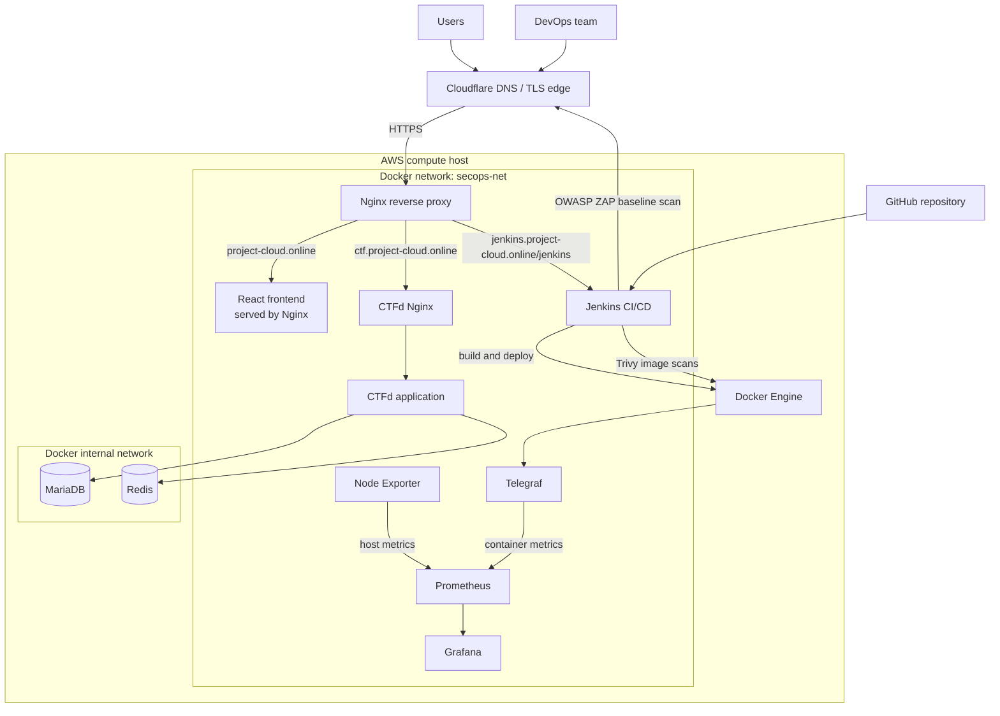
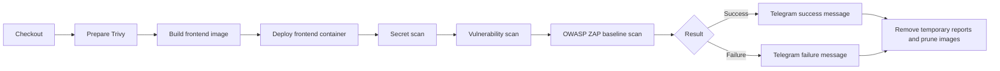

<div align="center">

# AWS DevSecOps & Monitoring Platform

**A containerized cloud platform with automated delivery, security gates, and full-stack observability.**

[](https://aws.amazon.com/)
[](https://www.docker.com/)
[](https://www.jenkins.io/)
[](https://trivy.dev/)
[](https://prometheus.io/)
[](https://grafana.com/)

React · CTFd · Jenkins · Trivy · OWASP ZAP · Prometheus · Grafana · Cloudflare

</div>

---

This educational team project demonstrates an end-to-end DevSecOps environment running on an Ubuntu-based AWS host. Cloudflare and Nginx expose a React website, a CTFd platform, and Jenkins, while Docker Compose manages the application, data, security, and monitoring services.

### Explore the project

[Architecture](#architecture) · [CI/CD pipeline](#cicd-pipeline) · [Monitoring](#monitoring-flow) · [Security](#security-design) · [Deployment](#deployment)

## Key capabilities

| Delivery | Security | Observability | Platform |
| --- | --- | --- | --- |
| Jenkins pipeline | Trivy image and secret scanning | Prometheus metrics | AWS-hosted Docker stack |
| Docker Compose deployment | OWASP ZAP baseline testing | Grafana dashboards | Cloudflare and Nginx routing |
| Telegram build notifications | Isolated data network | Node Exporter host metrics | React and CTFd services |
| Reproducible container builds | Jenkins-managed credentials | Telegraf container metrics | MariaDB and Redis persistence |

## Architecture



### Traffic flow

1. Cloudflare provides the public DNS and forwards HTTPS traffic to the AWS host.
2. The edge Nginx container terminates the origin-side TLS connection with a Cloudflare Origin certificate.
3. Nginx selects the destination using the requested hostname:
   - `project-cloud.online` routes to the React frontend.
   - `ctf.project-cloud.online` routes to the CTFd reverse proxy.
   - `jenkins.project-cloud.online/jenkins/` routes to Jenkins.
4. CTFd communicates with MariaDB and Redis on an internal Docker network that is not exposed publicly.

## Components

| Layer | Technology | Responsibility |
| --- | --- | --- |
| Edge | Cloudflare | Public DNS, edge TLS, and traffic forwarding |
| Gateway | Nginx | HTTPS redirection, virtual-host routing, and reverse proxying |
| Frontend | React, Nginx | Static website built with Node.js and served by Nginx |
| Challenge platform | CTFd | Security challenge and event platform |
| Data | MariaDB | Persistent CTFd relational data |
| Cache | Redis | CTFd cache and temporary data |
| CI/CD | Jenkins | Checkout, build, deployment, security scans, cleanup, and notifications |
| Container security | Trivy | Vulnerability and secret scanning of the frontend image |
| Dynamic security | OWASP ZAP | Baseline scan against the deployed web application |
| Metrics | Prometheus | Metrics collection and time-series storage |
| Host monitoring | Node Exporter | CPU, memory, filesystem, and operating-system metrics |
| Container monitoring | Telegraf | Docker container metrics exposed in Prometheus format |
| Visualization | Grafana | Dashboards for infrastructure and container observability |
| Notifications | Telegram Bot API | Jenkins build success and failure notifications |

## CI/CD pipeline

The [`Jenkinsfile`](./Jenkinsfile) defines the following workflow:



### Pipeline behavior

- Jenkins reads sensitive values from its Credentials store rather than keeping production values in the pipeline.
- The pipeline creates a temporary `.env` file for Docker Compose and removes it during post-build cleanup.
- Trivy generates a JSON report and blocks the pipeline when HIGH or CRITICAL findings are detected.
- OWASP ZAP produces JSON, HTML, and Markdown baseline reports.
- Telegram notifications include the build number, branch, commit, duration, and build-log URL.

> **Current limitation:** the present pipeline deploys the frontend before running the blocking Trivy checks, while the ZAP command is report-only. A stricter production pipeline should scan the image before deployment, publish reports as Jenkins artifacts, and promote only an immutable image that passed every required gate.

## Monitoring flow

```text
AWS host metrics ------> Node Exporter ----\
                                           +--> Prometheus --> Grafana dashboards
Docker container data -> Telegraf --------/
```

- Prometheus scrapes its own metrics, Node Exporter on port `9100`, and Telegraf on port `9273` every five seconds.
- Telegraf reads container statistics through the Docker socket and exposes them in Prometheus format.
- Grafana uses Prometheus as its data source and stores its state in a Docker volume.
- Persistent volumes retain Prometheus and Grafana data across container restarts.

## Security design

- Cloudflare Origin TLS certificates secure the Cloudflare-to-origin connection.
- HTTP requests are redirected to HTTPS by Nginx.
- MariaDB and Redis are attached to an internal Docker network.
- Production secrets are retrieved from Jenkins Credentials and are not meant to be committed.
- Trivy checks the built image for vulnerabilities and exposed secrets.
- The image security gates run before the frontend deployment stage.
- OWASP ZAP performs a dynamic baseline assessment of the deployed site.
- Read-only volume mounts are used for configuration files and host metric paths where supported.
- Scan reports are archived in Jenkins before temporary files are removed.
- Production container images are pinned to explicit maintained versions.

### Production hardening opportunities

- Put Jenkins and Grafana behind Cloudflare Access, a VPN, or another identity-aware access layer.
- Replace direct Docker socket access with a more restricted build and monitoring mechanism.
- Run application containers with non-root users and read-only filesystems where possible.
- Add automated dependency checks, software bills of materials, image signing, and centralized log collection.
- Add a deployment rollback strategy and use a dedicated test environment for pre-production DAST.

## Repository structure

```text
.
|-- CTFd/                         # CTFd source and reverse-proxy configuration
|-- frontend/                     # React application and multi-stage Docker build
|-- jenkins-docker/               # Jenkins image with Docker tooling
|-- nginx/                        # Edge and environment-specific Nginx configuration
|-- prometheus/                   # Prometheus scrape configuration
|-- telegraf/                     # Docker metrics configuration
|-- node-exporter-textfile/       # Textfile metrics directory
|-- Jenkinsfile                   # CI/CD and security pipeline
|-- docker-compose.prod.yml       # Production application stack
|-- docker-compose.monitoring.yml # Monitoring stack
|-- docker-compose.local.yml      # Local override
`-- docker-compose.yml            # Development stack
```

## Prerequisites

- Linux host (the production configuration assumes Ubuntu paths)
- Docker Engine with the Docker Compose plugin
- A Cloudflare-managed domain
- Cloudflare Origin certificate and private key on the host
- Jenkins credentials configured for application secrets and Telegram notifications

## Required configuration

The production application stack expects these variables:

```dotenv
DB_ROOT_PASSWORD=<mariadb-root-password>
DB_PASSWORD=<ctfd-database-password>
CTFD_SECRET_KEY=<long-random-secret>
MARIADB_USER=ctfd
MARIADB_DATABASE=ctfd
DATABASE_URL=mysql+pymysql://ctfd:<password>@db/ctfd
REDIS_URL=redis://cache:6379
```

The monitoring stack also expects the host Docker group ID:

```bash
export DOCKER_GID="$(getent group docker | cut -d: -f3)"
```

Do not commit the populated `.env` file, private keys, API tokens, or Jenkins credentials.

## Deployment

Create the application stack first because the monitoring Compose file joins its external network:

```bash
docker compose -p cloud_projet -f docker-compose.prod.yml up -d --build
docker compose -f docker-compose.monitoring.yml up -d
```

Inspect the deployment:

```bash
docker compose -p cloud_projet -f docker-compose.prod.yml ps
docker compose -f docker-compose.monitoring.yml ps
```

Stop the containers without deleting persistent volumes:

```bash
docker compose -f docker-compose.monitoring.yml down
docker compose -p cloud_projet -f docker-compose.prod.yml down
```

## Jenkins credentials

The pipeline references the following Jenkins credential IDs:

| Credential ID | Purpose |
| --- | --- |
| `DB_ROOT_PASSWORD` | MariaDB administrator password |
| `DB_PASSWORD` | CTFd database password |
| `CTFD_SECRET_KEY` | CTFd application secret |
| `MARIADB_USER` | Database user |
| `MARIADB_DATABASE` | Database name |
| `DATABASE_URL` | CTFd database connection string |
| `REDIS_URL` | Redis connection string |
| `TELEGRAM_TOKEN_ID` | Telegram bot token |
| `TELEGRAM_CHAT_ID` | Telegram destination chat ID |

## Project scope

This repository is an educational team project focused on cloud deployment, container orchestration, CI/CD, DevSecOps controls, and monitoring. It demonstrates an end-to-end architecture, while the hardening items listed above would be required before using the platform for a production workload.
